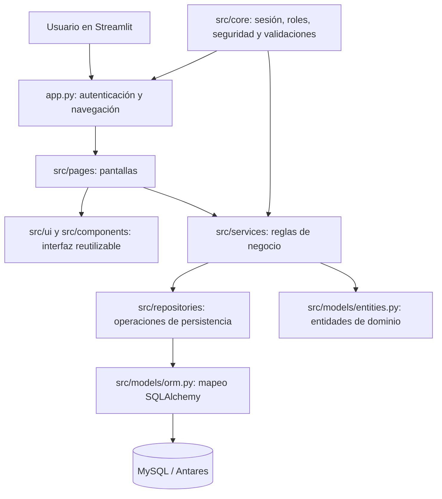

# Documentación integral del proyecto

## Propósito y alcance

Esta guía explica la aplicación de gestión de Herrería Don Francisco: su interfaz, reglas del negocio, autenticación, acceso a datos, modelos y archivos SQL. Describe el comportamiento que se observa en el código y no contiene contraseñas ni valores del archivo `.env`.

## 1. Arquitectura general

La página reúne controles y muestra resultados. Los servicios aplican validaciones y reglas. Los repositorios encapsulan consultas y cambios persistentes. Los modelos ORM representan las tablas MySQL y `Usuario` es una entidad de dominio separada del ORM.

## 2. Inicio y navegación

### `app.py`

Configura Streamlit, aplica el tema y comprueba si hay una sesión válida. Sin sesión, muestra el autenticar_usuario. Con sesión, muestra el usuario en la barra lateral y construye el menú según el rol.

`inicio()` presenta indicadores y accesos rápidos. El Auditor ve el sistema en modo de consulta. El Administrador accede también a la página de usuarios. Los módulos principales son Clientes, Presupuestos, Materiales, Pagos, Trabajos y Proveedores.

### `src/pages/`

Cada archivo es una página multipágina de Streamlit. Las páginas consultan sus servicios, componen elementos reutilizables y controlan qué acciones aparecen según el rol.

| Archivo | Responsabilidad |
| --- | --- |
| `01_clientes.py` | Alta, consulta y selección de clientes y contactos. |
| `02_presupuestos.py` | Historial, creación y cambio de estado de presupuestos. |
| `03_materiales.py` | Catálogo, precios y alta de materiales. |
| `04_pagos.py` | Registro de cobros y consulta de pagos asociados a presupuestos. |
| `05_trabajos.py` | Inicio de órdenes desde presupuestos aprobados y seguimiento de estados y fechas. |
| `06_usuarios.py` | Alta de cuentas, listado y administración de roles; acceso de Administrador. |
| `07_proveedores.py` | Consulta de proveedores y materiales asociados. |
| `__init__.py` | Inicializador del paquete de páginas. |

## 3. Interfaz

### `src/ui/autenticar_usuario.py`

`mostrar_inicio_sesion()` presenta el formulario de acceso, recoge las credenciales, llama al servicio de autenticación e inicia la sesión al validar correctamente.

### `src/ui/__init__.py`

Reúne componentes para mantener la misma presentación en todas las páginas:

- `aplicar_tema()` aplica reglas visuales globales.
- `obtener_logo_uri()` prepara el logo para mostrarlo en HTML.
- `encabezado_pagina()`, `encabezado_seccion()` y `tarjeta_indicador()` construyen encabezados, secciones e indicadores.
- `mostrar_usuario_lateral()` presenta identidad y rol en la barra lateral.
- `formatear_moneda()` formatea importes.
- `mostrar_tabla_registros()` presenta registros con búsqueda, contador y estado vacío.
- `mostrar_alta_cliente()` permite reutilizar el alta de clientes desde distintas vistas.
- `mostrar_estado_vacio()` comunica que no hay datos o resultados.
- `mostrar_error_bd()` y `gestionar_error_bd()` presentan errores técnicos de forma controlada para el usuario.

### `src/components/budget_form.py`

`mostrar_formulario_presupuesto()` es el formulario reutilizable de presupuestos. Permite elegir cliente y domicilio, indicar el tipo y ubicación del trabajo, elegir cálculo por porcentaje o por hora, agregar materiales y revisar los importes. Comprueba permisos antes de habilitar la escritura.

## 4. Seguridad, sesión y validaciones

### `src/core/authorization.py`

Define los roles permitidos y las comprobaciones comunes:

- `normalizar_rol()` normaliza el valor y usa el rol de solo lectura si no reconoce el recibido.
- `puede_escribir()` determina si el usuario puede crear o actualizar.
- `es_administrador()` verifica el rol de Administración.

Roles: Administrador, Operador y Auditor. Las páginas y formularios consultan estas funciones antes de mostrar acciones.

### `src/core/session.py`

- `iniciar_sesion_usuario()` guarda en el estado de Streamlit los datos públicos de la identidad y su rol.
- `obtener_usuario_actual()` recupera la identidad y actualiza la actividad; vence la sesión por inactividad.
- `cerrar_sesion_usuario()` limpia identidad y actividad.

La contraseña y su hash no se guardan en la sesión del navegador.

### `src/core/security.py`

`generar_hash_contrasena()` genera el hash bcrypt de una contraseña. `verificar_contrasena()` compara una contraseña ingresada con el hash almacenado. El flujo trabaja con hashes, no compara valores en texto plano.

### `src/core/validators.py`

Contiene validaciones compartidas:

- `limpiar_texto()` recorta y compacta espacios, requiere contenido y limita longitud.
- `normalizar_cuit()` elimina separadores y acepta de 8 a 11 dígitos.
- `mostrar_cuit()` aplica formato `XX-XXXXXXXX-X` a 11 dígitos; presenta de 8 a 10 dígitos sin separadores.
- `validar_decimal_positivo()` comprueba que un valor sea decimal finito y positivo, con opción para permitir cero.

## 5. Servicios y lógica del negocio

Los servicios separan las reglas de la interfaz y sirven como entrada para las páginas.

### `src/services/auth_service.py`

`AuthService` agrupa las operaciones de cuentas:

- `autenticar_usuario()` valida credenciales y entrega la identidad o un mensaje de error.
- `listar_usuarios()` prepara el listado para administración.
- `crear_cuenta()` valida y crea una cuenta con rol permitido.
- `actualizar_rol()` valida cambios de rol y protege las reglas de administración, como conservar al menos un administrador.

### `src/services/client_service.py`

`listar_clientes()` prepara el padrón y sus contactos. `crear_cliente()` valida identificación, nombre, apellido y, opcionalmente, los datos iniciales de contacto. `obtener_contactos_cliente()` entrega los domicilios y teléfonos asociados.

### `src/services/budget_service.py`

`listar_presupuestos()` prepara el historial. `totales()` calcula importes de materiales, mano de obra y total. `crear_presupuesto()` valida y crea el presupuesto y sus detalles. `actualizar_estado_presupuesto()` actualiza su estado. `obtener_materiales_para_presupuesto()` prepara materiales para cotizar.

### `src/services/material_service.py`

`listar_proveedores()` y `listar_materiales()` preparan catálogos. `crear_proveedor()` valida y crea un proveedor. `crear_material()` valida descripción y precio, comprueba el proveedor y crea el material asociado.

### `src/services/payment_service.py`

`listar_pagos()` prepara el historial. `crear_pago()` valida monto, fecha, método y referencia antes de registrar el pago para un presupuesto existente.

### `src/services/work_service.py`

`listar_trabajos()` prepara las órdenes de trabajo. `crear_trabajo()` permite iniciar una orden desde un presupuesto aprobado y evita duplicarla. `actualizar_trabajo()` valida estado, observaciones y coherencia de fechas.

### `src/services/dashboard_service.py`

`obtener_resumen_panel()` reúne los datos que necesita el panel, como cantidades de presupuestos, clientes, trabajos e ingresos del mes.

## 6. Entidades y modelos de persistencia

### `src/models/entities.py`

`Usuario` es una `dataclass` inmutable con los datos de dominio de una cuenta. Mantiene separada la identidad usada por autenticación de la representación ORM de una fila.

### `src/models/orm.py`

Define las clases SQLAlchemy que se mapean a tablas. Las asociaciones `relationship()` permiten recorrer relaciones entre objetos; las claves foráneas, restricciones `CHECK` y restricciones `UNIQUE` reflejan reglas de integridad.

| Clase ORM | Tabla | Función |
| --- | --- | --- |
| `CiudadORM` | `ciudades` | Localidades de contactos y lugares de trabajo. |
| `ClienteORM` | `clientes` | Identificación, nombre y apellido del cliente. |
| `ClientesContactoORM` | `clientes_contacto` | Domicilios, ciudad, teléfono y período de vigencia de un contacto. |
| `UbicacionTrabajoORM` | `ubicacion_trabajo` | Domicilio y ciudad donde se realiza una obra. |
| `TipoTrabajoORM` | `tipos_trabajo` | Catálogo de tipos de trabajo presupuestables. |
| `PresupuestoORM` | `presupuesto` | Fechas, ubicación, tipo, descripción, cálculo y estado. |
| `ProveedorORM` | `proveedores` | Nombre, rubro y teléfono de un proveedor. |
| `MaterialORM` | `materiales` | Descripción, precio de referencia y proveedor. |
| `DetallePresupuestoORM` | `detalle_presupuesto` | Material, cantidad, precio aplicado y subtotal de una cotización. |
| `HistorialClienteORM` | `historial_cliente` | Movimientos descriptivos vinculados a clientes. |
| `PagoORM` | `pagos` | Cobros, método, fecha y referencia de comprobante. |
| `TrabajoORM` | `trabajos` | Orden de fabricación, estado, fechas y observaciones. |
| `UsuarioORM` | `usuarios` | Cuenta, hash de contraseña y rol de acceso. |

Relaciones principales: una ciudad tiene varios contactos y ubicaciones; un cliente tiene varios contactos e historial; un contacto y una ubicación pueden aparecer en varios presupuestos; un presupuesto tiene detalles y pagos, y como máximo una orden de trabajo; un proveedor ofrece varios materiales; un material puede aparecer en distintos detalles de presupuesto.

**Compatibilidad con el esquema activo:** el ORM conserva algunos nombres físicos históricos del esquema Antares. Por ejemplo, el atributo Python `ClienteORM.cuit_cliente` se mapea a la columna `clientes.cuilt_cliente`; `fk_material` se mapea a `detalle_presupuesto.fk_materiales`; la contraseña se mapea a la columna física `usuarios.contraseña`. No se deben renombrar esas columnas como parte de un cambio de interfaz.

## 7. Repositorios y ciclo de transacción

### `src/repositories/`

Cada repositorio concentra las consultas de una familia de datos. Los servicios los llaman; las páginas no construyen consultas directamente.

| Archivo / clase | Responsabilidad |
| --- | --- |
| `client_repository.py` / `ClientRepository` | Buscar, crear y listar clientes y contactos. |
| `budget_repository.py` / `BudgetRepository` | Consultar presupuestos, crear ciudades, tipos, ubicaciones, contactos y detalles relacionados. |
| `material_repository.py` / `MaterialRepository` | Consultar y crear materiales y proveedores. |
| `payment_repository.py` / `PaymentRepository` | Listar y crear pagos. |
| `work_repository.py` / `WorkRepository` | Listar, crear, buscar y actualizar trabajos. |
| `user_repository.py` / `UsuarioRepository` | Buscar cuentas, contar administradores, listar y crear usuarios. |
| `dashboard_repository.py` / `DashboardRepository` | Consultar agregados para los indicadores del inicio. |
| `__init__.py` | Inicializador del paquete. |

### `src/core/database.py`

Crea el motor SQLAlchemy y la fábrica de sesiones. `obtener_sesion_bd()` es un administrador de contexto: confirma la transacción cuando el bloque termina bien; ante una excepción revierte los cambios; siempre cierra la sesión. `probar_conexion_bd()` ejecuta una consulta mínima para probar conectividad.

## 8. Configuración de conexión y secretos

### `src/core/config.py`

Lee las variables del entorno con `python-dotenv`. Si `DATABASE_URL` tiene valor, la utiliza directamente; si no, compone la URL con host, puerto, base, usuario y contraseña. La clase `Settings` agrupa la configuración inmutable de la aplicación.

### `.env.example`

Es una plantilla de nombres de variables, no contiene credenciales válidas. Incluye la configuración de aplicación, MySQL, tiempo de sesión y opciones de seguridad. El archivo real `.env` está excluido de Git; no se deben copiar sus valores a documentación, capturas ni repositorios.

Los campos `APP_SECRET`, `DB_SSL_CA`, `FERNET_KEY` y `BCRYPT_ROUNDS` aparecen en configuración, pero no todos están conectados actualmente a una operación del sistema. En particular, el generador bcrypt actual usa la configuración predeterminada de la biblioteca. `SESSION_TIMEOUT_MINUTES` sí se usa para el vencimiento de sesión.

## 9. Esquema SQL y scripts de base de datos

### `database/schema.sql`

Es el esquema de referencia para crear una base nueva. Declara la base `presupuesto_herreria_poo` con `utf8mb4` y crea las tablas `ciudades`, `clientes`, `clientes_contacto`, `ubicacion_trabajo`, `tipos_trabajo`, `presupuesto`, `proveedores`, `materiales`, `detalle_presupuesto`, `historial_cliente`, `pagos`, `trabajos` y `usuarios`.

Incluye claves primarias, claves foráneas, unicidad y validaciones. Entre ellas: no se permiten precios negativos ni pagos no positivos; las cantidades de detalles deben ser mayores que cero; las fechas finales no pueden preceder a las iniciales; y el presupuesto exige los campos correspondientes a su cálculo por porcentaje o por hora.

### `database/migrations/20261119_complete_live_schema.sql`

Migración preparada para adaptar la base Antares existente sin reemplazar sus datos. Agrega el catálogo de tipos de trabajo y campos de presupuesto; asigna el tipo inicial “Sin especificar”; marca como aprobado el presupuesto que ya tenga una orden; agrega referencias y restricciones; normaliza los estados existentes de trabajo; y conserva nombres físicos históricos como `cuilt_cliente` y `fk_materiales`.

El archivo es una migración manual de una sola ejecución, no un script idempotente ni un inicializador automático. No se debe ejecutar nuevamente sobre una base que ya recibió los cambios.

### `database/migrations/20261119_add_usuario_rol.sql`

Agrega la columna `rol` a `usuarios` con los valores Administrador, Operador y Auditor. Las cuentas previas reciben `OPERADOR` por defecto. Incluye como comentario un ejemplo para asignar el primer administrador, que debe revisarse y adaptarse antes de usar.

### `database/create_app_user.sql`

Ejemplo manual para crear el usuario técnico de conexión de la aplicación y otorgarle permisos `SELECT`, `INSERT`, `UPDATE` y `DELETE` sobre el esquema. Ese usuario MySQL es distinto de las cuentas que inician sesión en Streamlit. El archivo contiene una contraseña de reemplazo, no una contraseña utilizable.

### `src/core/init_db.py`

Actualmente contiene solamente una descripción de módulo: no crea tablas ni ejecuta migraciones. Los scripts SQL de `database/` se administran por separado.

## 10. Otros archivos del proyecto

| Archivo | Uso |
| --- | --- |
| `requirements.txt` | Dependencias Python fijadas o acotadas: Streamlit, SQLAlchemy, PyMySQL, pandas, bcrypt, dotenv y utilidades de exportación. |
| `.gitignore` | Evita incluir `.env`, secretos de Streamlit, entornos virtuales, cachés y archivos del IDE en Git. |
| `.streamlit/config.toml` | Tema claro, colores del sistema y tipografía para Streamlit. |
| `src/assets/logo_don_francisco.png` | Logo utilizado en el autenticar_usuario y elementos de marca. |
| `ARCHITECTURE.md` | Resumen previo de capas, roles y consideraciones de autenticación. |
| `SISTEMA_DISENO_INTERFAZ.md` | Tokens, componentes y criterios visuales de la interfaz. |
| `modelms/orm.py` | Archivo vacío; no contiene modelos activos. Los modelos usados por la aplicación están en `src/models/orm.py`. |
| `src/**/__init__.py` | Archivos que delimitan paquetes Python; algunos reexportan entidades y otros están vacíos. |
| `src/core/create_user.py` | Script interactivo de consola que solicita nombre, usuario y contraseña para crear una cuenta mediante `AuthService`. Se ejecuta como script; no se debe importar desde la aplicación porque solicita datos al iniciar el módulo. |

## 11. Flujo completo de una operación

1. El usuario abre una página y completa un formulario.
2. La interfaz consulta permisos y recopila los datos.
3. El servicio limpia y valida los valores y aplica reglas del negocio.
4. El repositorio ejecuta la operación mediante SQLAlchemy y el modelo ORM.
5. La sesión confirma o revierte la transacción y se cierra.
6. La interfaz muestra el resultado o un mensaje de error.

En el acceso, `AuthService` comprueba las credenciales, `Usuario` representa la identidad, `iniciar_sesion_usuario()` conserva el estado público y las comprobaciones de rol autorizan cada operación posterior.
